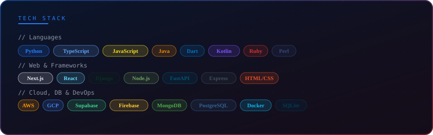
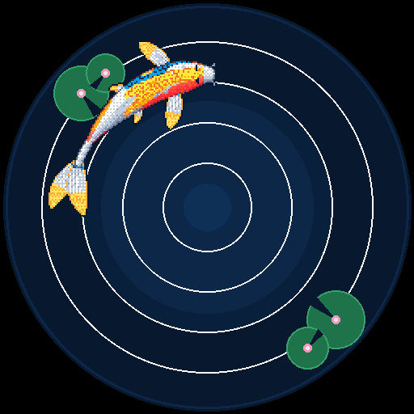

<!-- ANAND JATOTHU — GitHub Profile README -->

---

---

---

## 🚀 Featured Projects

| Project | Description | Stack | Live |
|---------|-------------|-------|------|
| **[StuLink](https://github.com/ANAND-JATOTHU/StuLink)** | Safe social learning & skill-sharing platform with RLS, parent portal, text-moderation engine (↓95% unsafe msgs) | Next.js · TS · React 19 · Supabase · Cloudinary | [▶ Demo](https://stu-link-web.vercel.app/) |
| **[Foodify](https://github.com/ANAND-JATOTHU)** | Dual-purpose food delivery & donation platform with map-based logistics (↓40% carbon footprint) | Django · Python · Stripe · Geoapify | — |
| **[SRUTHI](https://github.com/ANAND-JATOTHU)** | Fully offline conversational AI assistant — Mistral-7B + Faster-Whisper + PyQt6 GPU GUI (83% task completion) | Python · Mistral LLM · CustomTkinter | — |
| **[Transvara](https://github.com/ANAND-JATOTHU)** | Secure & fast file transfer web app | Next.js · Node.js | [▶ Demo](https://transfer-app-frontend.vercel.app/) |

---

## 🐟 Git Koi Pond

<!-- Koi Background Options:
     - koi/koi-zen-pond.gif    (Deep Zen Water Pond with ripples & lily pads - ACTIVE)
     - koi/koi-tokyonight.gif  (TokyoNight Card with neon borders)
     - koi/koi.gif             (Transparent / clean)
-->

<em>An animated pixel-art koi that grows with contributions, maps colors to top languages, and swims according to recent activity. Powered by <a href="https://github.com/yalongwastaken/git-koi">git-koi</a>.</em>

---

## 🐍 Contribution Graph Snake

<picture>
  <source media="(prefers-color-scheme: dark)" srcset="assets/github-contribution-grid-snake-dark.svg">
  <source media="(prefers-color-scheme: light)" srcset="assets/github-contribution-grid-snake.svg">
  
</picture>

---

## 📊 GitHub Stats

 

---

**[🌐 Portfolio](https://anandjatothu.me)** &nbsp;·&nbsp; **[💼 LinkedIn](https://linkedin.com/in/anandjatothu)** &nbsp;·&nbsp; **[⚫ GitHub](https://github.com/ANAND-JATOTHU)** &nbsp;·&nbsp; **[✉ Email](mailto:anand.jatothu.27@gmail.com)**

---

