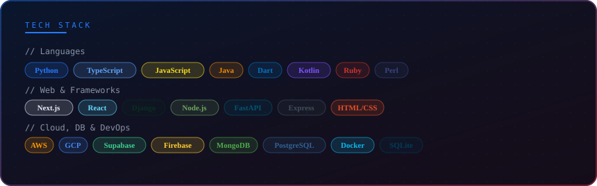
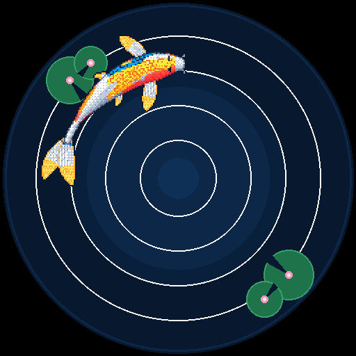

<!-- ANAND JATOTHU — GitHub Profile README -->

---

### 👋 About Me

I am a third-year **B.Tech Information Technology student** at **Teegala Krishna Reddy Engineering College (TKREC)** in Hyderabad. I have a strong interest in **Full-Stack Web Development**, **Python backend engineering**, and **practical Artificial Intelligence**.

I enjoy taking an idea, exploring how it operates under the hood, and building it into a reliable, working application. Rather than claiming expertise across everything, I believe in staying grounded, being open to feedback, and learning continuously by writing code every day.

- 🌱 **Current Focus:** Deepening my understanding of Data Structures & Algorithms, modern web frameworks, and local AI toolchains.
- 💼 **Internship Experience:** Former Python Development Intern at **Kinetrexa Software** (building role-based portals & APIs) and **ServiceNow Virtual Intern**.
- 🎯 **What I'm Looking For:** Software Development Engineer (SDE) internships where I can contribute to real-world codebases, learn from experienced mentors, and add value.

---

---

## 🚀 Featured Projects

| Project | Description | Stack | Links |
|:---|:---|:---|:---:|
| **[Academia (Kinetrexa)](https://github.com/ANAND-JATOTHU)** | Role-based student & attendance management system built during my internship. Features multi-tier access (Admin, Teacher, Student), automated tracking, CSV data pipelines, and dynamic vector PDF ID generation. | Django · Tailwind CSS · SQLite / PostgreSQL | [GitHub](https://github.com/ANAND-JATOTHU) |
| **[StuLink](https://github.com/ANAND-JATOTHU/StuLink)** | Safe social learning and skill-sharing platform for students. Designed with Supabase Row Level Security (RLS), parent access portal, and an automated text moderation engine. | Next.js · TypeScript · React 19 · Supabase · Cloudinary | [▶ Demo](https://stu-link-web.vercel.app/) · [GitHub](https://github.com/ANAND-JATOTHU/StuLink) |
| **[SRUTHI](https://github.com/ANAND-JATOTHU)** | Fully offline conversational AI assistant powered by a local quantized Mistral-7B model, Faster-Whisper for low-latency speech-to-text, and a custom PyQt6 GUI. | Python · Mistral LLM · Faster-Whisper · PyQt6 | [GitHub](https://github.com/ANAND-JATOTHU) |
| **[Transvara](https://github.com/ANAND-JATOTHU)** | Fast and secure web-based peer-to-peer file transfer application focused on simplicity and client-side encryption. | Next.js · Node.js · WebRTC | [▶ Demo](https://transfer-app-frontend.vercel.app/) · [GitHub](https://github.com/ANAND-JATOTHU) |

---

---

## 💻 GitHub Works & Open Source Journey

To me, GitHub is my digital workshop. Every commit, issue, and repository represents a step forward in my engineering journey:

- **Building by Doing:** I learn best by getting my hands dirty with code—whether architecting multi-role web apps, experimenting with offline AI models, or building utility tools.
- **Code Quality & Best Practices:** I strive to write readable, modular code with proper type definitions, role-based security, and clean documentation.
- **Workflow Automation:** I enjoy setting up automated GitHub Actions workflows (CI/CD pipelines, image compositing, and scheduled scripts) to keep projects healthy and maintainable.

### 🐟 The Git Koi Pond

<!-- Koi Background Options:
     - koi/koi-zen-pond.gif    (Deep Zen Water Pond with ripples & lily pads - ACTIVE)
     - koi/koi-tokyonight.gif  (TokyoNight Card with neon borders)
     - koi/koi.gif             (Transparent / clean)
-->

<em>An animated pixel-art koi that grows with cumulative contributions, maps colors to top languages, and swims according to daily commit activity. Powered by <a href="https://github.com/yalongwastaken/git-koi">git-koi</a>.</em>

### 🐍 Contribution Graph Snake

<picture>
  <source media="(prefers-color-scheme: dark)" srcset="assets/github-contribution-grid-snake-dark.svg">
  <source media="(prefers-color-scheme: light)" srcset="assets/github-contribution-grid-snake.svg">
  
</picture>

---

## 💼 Connect on LinkedIn

I regularly share what I'm learning, project build breakdowns, and software discoveries on LinkedIn. Whether you're a recruiter seeking an enthusiastic intern, a fellow developer, or an engineer willing to share advice, I would love to connect!

---

## 📊 GitHub Stats & Consistency

 

---

---

